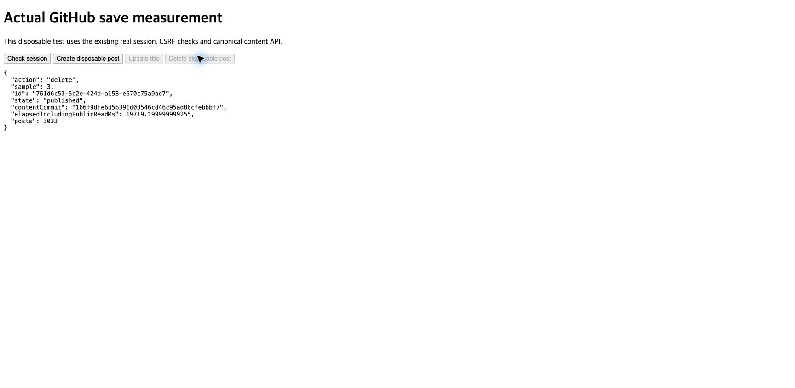

# Save optimization — actual GitHub verification

Actual title-only save median decreased from **22.975s to 18.613s (19.0%)**. Three updated samples were 22.797s, 18.613s and 17.302s. Request payload decreased 39.5%; consumed decoded response bytes decreased 39.0%. All five real mutations and their automatic push workflows succeeded.

## Stage comparison

Both columns use the actual request whose total is the median of its three samples. These are not independently selected per-stage medians.

| Stage | Before | After | Requests before | Requests after |
|---|---:|---:|---:|---:|
| Source lookup and validation |2.950s|3.114s|7|7|
| Source commit and candidate check |3.138s|2.649s|5|5|
| Candidate tree and previous public artifact |3.577s|2.526s|9|7|
| Changed post and JSON generation |0.477s|0.418s|1|1|
| Public upload |10.259s|8.539s|5|4|
| Canonical advance and final verification |2.572s|1.366s|6|2|
| Total |22.975s|18.613s|33|26|

After: 18.168s awaited GitHub spans and 0.445s other time. Source lookup remained the same seven calls; its first new observation was 6.541s, showing transport variation. The comparison does not establish a fixed 19% speedup for every save.

| Transfer metric | Before | After | Reduction |
|---|---:|---:|---:|
| Request payload |11.444MB|6.920MB|39.5%|
| Consumed decoded responses |18.308MB|11.165MB|39.0%|
| GitHub calls |33|26|7 calls|
| GitHub writes |10|9|1 write|

MB is decimal. Payload excludes HTTP/TLS headers; response bytes are decompressed bytes consumed by the handler, not compressed wire download size.

## Implementation and compatibility

- `index.json` and public body JSON retain their reader format. Oversized JSON uploads choose whichever complete Git blob request is smaller: UTF-8 or base64. Returned SHA must match the exact generated bytes.
- Writer-only `generation.json` uses a version 2 JSON envelope containing gzip+base64. Decoded state stays version 1. The final corpus cache is 545,716 bytes, down from 2,650,012 decoded bytes. The new generator accepts legacy version 1 caches. The saved old generator successfully consumed a version 2 artifact by taking its existing full-generation fallback, then produced a valid legacy cache and ready ref.
- Gzip decoding is limited to 16 MiB. Existing decoded file and aggregate budgets remain. Cache bytes must match the verified manifest before decoding. Malformed encodings, gzip, JSON and oversized decoded content fail before publication writes.
- Independent oversized blobs use at most two workers. Every in-flight upload drains on failure; tree/commit/ref writes begin only after all blob hashes pass. In this real workload the compressed cache fits the inline tree, so only the index needs a separate blob. Two-worker overlap and its failure behavior were verified on large-document fixtures; no actual concurrency speedup is claimed for these three saves.
- The candidate inventory comes from the complete base snapshot plus the exact successful tree delta. Actual blob lengths cover new assets and authored files. Source validation still runs on the derived inventory. Recovery snapshots use fetched proof. No readiness proof survives the request.
- After publication and canonical PATCH, the fresh canonical head is still checked. Only the identical, already-prepared candidate avoids redundant publication reads. A distinct descendant still needs its own publication; later retries revalidate persisted artifacts.

UI, auth, CSRF, canonical conflict handling, bulk receipts and reader code were preserved. Existing public body SHA/size inventory matches for all 3,033 original posts after cleanup. The full index stays 5,560,675 bytes. Reader latency was not re-benchmarked.

## Actual GitHub operations and cleanup

| Operation | Handler time | GitHub calls | Writes |
|---|---:|---:|---:|
| Create disposable post |22.685s|25|10|
| Title update 1 |22.797s|26|9|
| Title update 2 |18.613s|26|9|
| Title update 3 |17.302s|26|9|
| Delete disposable post |17.257s|26|8|

The control page called the real HTTP handler using the existing OAuth session and CSRF token. It created a small post with a valid editor snapshot, then made three title-only updates. Public index title/count checks followed each mutation. The measured POST times exclude source loading before the click, the final public read, editor rendering and browser/export work. Screenshot elapsed time includes the public read and therefore differs from the table.

All 10,294 original source file Git hashes match. The temporary post and editor source are gone, leaving 3,033 posts. Both task server listeners and the task Chrome tab were closed. This task did not restart the preview or log out. The final audit observed the preview PID change from41523 to69070 outside this task; actor/cause and the exact current served build are unverified. [Cleanup proof](cleanup.json), [workflow results](workflow-runs.json), [final workflow](https://github.com/gyungsubLee/subdev-blog-content/actions/runs/41846841277).

The generator-only commit is [`624cdbaa2076bb4db83839fb67985fa4838168b3`](https://github.com/gyungsubLee/subdev-blog/commit/624cdbaa2076bb4db83839fb67985fa4838168b3). Its branch and `PUBLIC_GENERATOR_APP_SHA` both match. Only `app/server/src/public-publication.mjs` changed against the previous trusted generator. Application main remains `27441173f257769add825aea596f7080d282e1ca`. This task performed no application merge/deployment or native rebuild. Measurements used fixed latest modules on the dedicated server; current normal-preview activation was not verified.

## Checks and evidence

- Publisher 23/23; request-local reuse 6/6; compressed-cache/integrity guards 5/5.
- Related server/domain regression 186/187 in the sandbox. Its sole failure was local socket `EPERM`; the exact runtime target passed 2/2 with socket access. No product assertion failed in that run.
- Fake-GitHub HTTP E2E and trace diagnostic 4/4. These are separate from the five actual GitHub writes above.
- Independent scoped review approved. Its minor negative-case coverage gap was covered by the five guard checks.
- Original and instrumented publishers produced identical artifact Git SHA. Fixed measured source hashes still matched the live source after all five saves.
- No full-suite, production build, deployment cold-start, native timing, bulk throughput or new reader latency claim. No UI/TypeScript/build configuration changed in this task; syntax checks and actual server execution covered the edited modules.

The original TDD encoding fixture first exceeded the existing source limit; it was corrected to a valid multi-post corpus before verifying the expected smaller-payload failure. Original RED logs retain that failed attempt. The operation-loop indentation changed concurrently; this task did not author it and retained it. Initial session checks were non-ready; the normal GitHub OAuth route renewed the expired session before any write. Initial push/pin attempts were rejected by automatic approval review; no rejected action dispatched. The user then explicitly approved the exact generator branch/SHA update in this chat before successful publication.

See [verification.json](verification.json), [analysis.json](analysis.json), [per-request trace](browser-api-traces.json), [instrumentation parity](instrumentation-parity.json), [source hashes](source-hashes.json), [legacy compatibility](legacy-cache-compatibility.log), [publisher checks](publisher-green.log), [related checks](regression.log), [permitted runtime checks](runtime-permitted.log), [HTTP checks](http-e2e.log), [guard checks](transfer-guards.tap) and [operation record](operation.json). Prior baseline: [stage profile](../2026-11-04-save-stage-profile/README.md).

## Remaining bottlenecks

The median-total sample's upload stage still takes 8.539s: index blob 4.064s, tree 2.924s, commit 0.563s and ready ref 0.878s. The full plain index remains necessary for running-reader compatibility. The compressed cache travels inline with the manifest in the tree request. Original source-tree lookup and six previous-artifact reads also remain. GitHub service and network conditions dominate the remaining time.

