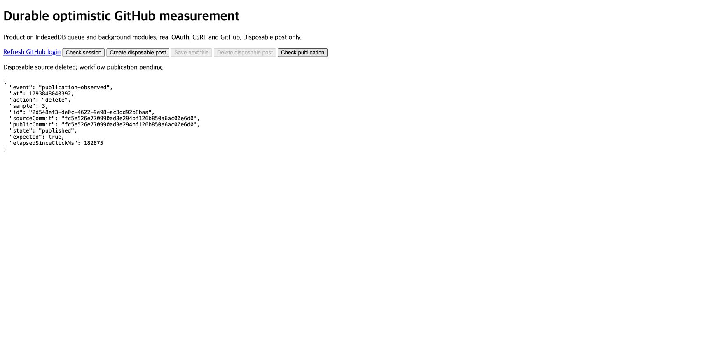

# 기기 저장·원본 동기화·workflow 공개 실측

구현과 실제 GitHub 실측을 완료했다. 제목 수정 3회의 화면 반영 중앙값은 **295.7ms**다. IndexedDB 저장 완료 알림은 **5.7ms**다. 원본 저장의 서버 POST 중앙값은 **6.122초**다.

이전 서버 POST 중앙값 18.613초보다 67.1% 짧았다. 이 비교는 서버 요청 시간만 비교한다. 이전 수치를 화면 지연으로 사용하지 않는다. 새 화면 수치는 실제 큐 모듈을 호출한 전용 측정 화면의 값이다.

## 바꾼 흐름

저장·게시를 누르면 기존 IndexedDB 큐가 payload를 먼저 보관한다. 화면은 이 변경을 반영한다. 기존 5초 정책 뒤 백그라운드 요청이 원본을 저장하고 receipt를 확인한다. 서버는 `saved`를 반환하며 공개 JSON을 생성하지 않는다.

기존 content push workflow가 공개 JSON을 생성하고 검증한다. 검증을 마치면 원본 계보를 따르는 `public-ready/main` 참조를 전진시킨다. 기본 reader는 이 참조의 정상 공개본을 읽는다. 준비 중이거나 생성이 실패하면 이전 정상 공개본을 유지한다.

클라이언트는 원본 commit과 공개 commit을 구분한다. 공개 준비 중에도 확인한 원본 변경을 화면에 유지한다. 검증한 공개 commit과 실제 index가 같을 때 기록의 화면 적용을 확인한다. 변경 없음 요청도 공개 상태를 추적한다. UI 구성·문구·스타일과 입력별 자동 게시 금지, 5초 정책, 재시도·충돌·복구·Worker 한도를 유지했다.

작은 UTF-8 변경 파일은 Git tree의 `content` 필드에 함께 넣는다. 큰 파일과 바이너리는 기존 blob 경로를 사용한다. 검증한 immutable 원본과 성공한 tree delta를 재사용한다. category·link·editor 검증, mutable head 확인과 요청 ID 복구를 유지한다. 임의 header나 body로 GitHub 동작을 합치지 않는다. [공식 tree API](https://docs.github.com/en/rest/git/trees#create-a-tree)의 계약을 따른다.

## 실제 제목 수정 3회

2026-11-05에 실제 OAuth·CSRF·owner 세션으로 고유한 임시 글 하나를 생성했다. 세 번 수정한 뒤 삭제했다. 서버와 측정 탭은 최신 모듈을 사용했다. 각 제목 저장은 같은 production 큐·저장소·서버를 사용했다. 제목 payload는 편집기의 title·tags·category·Markdown·assets·editor 형태를 따랐다.

| 표본 | IndexedDB 완료 알림 ms | 독립 읽기 확인 ms | 화면 반영 ms | 전송 전 대기 초 | 전송→원본 확인 초 | 클릭→원본 확인 초 | 클릭→공개 준비 초* |
|---|---:|---:|---:|---:|---:|---:|---:|
| 1 | 5.7 | 245.5 | 295.7 | 5.121 | 5.935 | 11.055 | 64.917 |
| 2 | 5.0 | 208.0 | 279.4 | 5.026 | 6.561 | 11.587 | 80.769 |
| 3 | 7.2 | 264.8 | 304.3 | 5.056 | 6.132 | 11.189 | 76.608 |
| 중앙값 | 5.7 | 245.5 | 295.7 | 5.056 | 6.132 | 11.189 | 76.608 |

IndexedDB 완료 알림은 readwrite transaction 완료 뒤 발생한다. 별도 readonly transaction으로 저장한 버전을 다시 확인했다. 화면 반영은 실제 overlay의 제목을 확인한 뒤 두 번의 animation frame으로 측정했다. 세 표본 모두 화면 반영 전에 시작한 API 요청은 0회이며 전송 bytes도 0이다.

전송 전 대기는 명목상 5초와 준비·예약 시간을 포함한다. 전송→원본 확인은 이 대기를 모두 제외한다. 클릭→원본 확인에서 명목상 5초만 뺀 값은 각각 6.055·6.587·6.189초다. 첫 생성의 category 조회는 제목 수정 세 표본에 포함하지 않는다.

*공개 준비 시간은 workflow의 ready PATCH 응답 시각에서 브라우저 클릭 시각을 뺀 추정값이다. runner와 브라우저의 시계 오차 한도는 측정하지 않았다. 각 workflow 안의 요청 시간은 같은 runner 시계로 측정했다. 수동 브라우저 공개 확인은 늦게 조회한 상한값이며 각각 93.096·143.288·134.703초였다. 이를 실제 공개 지연으로 해석하지 않는다.

## 구간별 요청과 bytes

아래 원본 저장 수치는 실제 서버 POST만 포함한다. 브라우저는 표본마다 838 bytes의 벌크 POST를 한 번 보냈다. 큐가 보관한 같은 요청을 두 번 반영하지 않았다.

| 표본 | 서버 POST 초 | GitHub 호출 | GitHub 쓰기 | GitHub 요청 bytes | 소비한 응답 bytes |
|---|---:|---:|---:|---:|---:|
| 1 | 5.924 | 12 | 4 | 1,266 | 3,770,308 |
| 2 | 6.546 | 12 | 4 | 1,275 | 3,770,349 |
| 3 | 6.122 | 12 | 4 | 1,275 | 3,770,349 |

이전 중앙값 표본은 26호출·9쓰기·요청 6,919,612 bytes·소비한 응답 11,165,283 bytes였다. 새 중앙값 표본은 12호출·4쓰기·요청 1,275 bytes·소비한 응답 3,770,349 bytes다. 이 감소는 저장 응답 경로의 비교다. 공개 업로드 자체가 사라진 것은 아니다.

공개 workflow는 표본마다 GitHub API 18회와 raw 읽기 5회를 실행했다. 쓰기는 5회였다. 원본 저장과 합치면 표본당 35호출·9쓰기다. 이전 workflow의 전체 호출을 같은 방식으로 측정하지 않아 전체 호출 감소율은 판정하지 않는다.

| 표본 | 공개 호출 | 공개 쓰기 | 공개 요청 bytes | 소비한 공개 응답 bytes |
|---|---:|---:|---:|---:|
| 1 | 23 | 5 | 6,903,414 | 12,425,949 |
| 2 | 23 | 5 | 6,903,414 | 12,426,013 |
| 3 | 23 | 5 | 6,903,410 | 12,426,013 |

요청 bytes는 HTTP·TLS header를 제외한 body 크기다. 응답 bytes는 압축 전 wire 크기가 아니라 계측기가 소비한 디코딩 bytes다. 원본 요청 ref의 404는 정상 미존재 확인이다. 각 원본 저장에서 이 오류 본문의 EOF를 소비하지 않은 1건도 `unfinishedBodies`로 보존했다.

전체 측정 세션의 API 요청도 별도로 기록했다. 아래 값은 수동 확인과 두 탭을 포함한다. 전체 편집기 사용량이나 한 저장의 비용으로 해석하지 않는다. 카테고리 조회의 GraphQL POST 1회는 읽기이며 쓰기에서 제외했다.

| API 구간 | 앱 요청 | GitHub·raw 호출 | 원격 쓰기 | 요청 bytes | 소비한 응답 bytes |
|---|---:|---:|---:|---:|---:|
| 원본 저장 5회 | 5 | 59 | 20 | 6,202 | 18,850,480 |
| 공개 상태 확인 | 47 | 319 | 0 | 0 | 31,466,263 |
| 공개 index 읽기 | 8 | 25 | 0 | 0 | 36,131,381 |
| 원본·카테고리 준비 | 7 | 28 | 0 | 856 | 22,562,759 |
| 세션 확인 | 3 | 0 | 0 | 0 | 0 |

workflow 표는 publisher의 GitHub·raw 요청만 포함한다. Actions checkout·npm 설치·로그 조회·watch·원본 SHA 감사 요청은 제외했다. 측정 화면은 전체 React 구독자를 실행하지 않아 확인 기록이 오래 유지됐다. 공개 상태 확인의 세션 합계를 정상 앱의 표본당 요청 수로 사용하지 않는다.

## 실제 workflow와 정리

| 작업 | 원본 commit | workflow | 결과 |
|---|---|---|---|
| 임시 글 생성 | `6429b63738535b3013177c0ae0e44a00d20d73e8` | [실행 41958210551](https://github.com/gyungsubLee/subdev-blog-content/actions/runs/41958210551) | success |
| 제목 수정 1 | `b6a79788fa0051ab04b34169307ca0793ba1f73c` | [실행 41958337725](https://github.com/gyungsubLee/subdev-blog-content/actions/runs/41958337725) | success |
| 제목 수정 2 | `0bbfb60111b43c511cfc15bddbb2b5121363aa1d` | [실행 41958534614](https://github.com/gyungsubLee/subdev-blog-content/actions/runs/41958534614) | success |
| 제목 수정 3 | `91f74f939d799ffa164174e8440d3c47e29b7dab` | [실행 41958811828](https://github.com/gyungsubLee/subdev-blog-content/actions/runs/41958811828) | success |
| 임시 글 삭제 | `fc5e526e770990ad3e294bf126b850a6ac00e6d0` | [실행 41959257829](https://github.com/gyungsubLee/subdev-blog-content/actions/runs/41959257829) | success |

추가로 [이전 원본 workflow](https://github.com/gyungsubLee/subdev-blog-content/actions/runs/41959633003)를 최신 삭제 공개본 뒤에 실행했다. 결과는 `superseded`였다. 15번 읽고 원격 쓰기는 0회였다. ready 참조와 canonical은 모두 `fc5e526e770990ad3e294bf126b850a6ac00e6d0`를 유지했다. 동시 생성·응답 유실·늦은 PATCH 경합은 폐기용 GitHub fixture 검사로 별도 확인했다.

사전 canonical은 `0bba342dfd2c537b767698330fd7a40be182eb9f`였다. 정리 후 canonical은 `fc5e526e770990ad3e294bf126b850a6ac00e6d0`다. **10,292개 원본 파일의 모든 SHA가 같고 글 수는 3,032개다.** 임시 Markdown과 editor 원본은 사라졌다. 기존 기록의 10,294파일·3,033글로 복원하지 않았다.

전용 generator 두 파일만 `e763d9adf0e07f77a1b0177895674f08922f9122`로 갱신했다. 기존 `PUBLIC_GENERATOR_APP_SHA`도 같다. 기존 workflow YAML과 명령은 유지했다. 앱 main은 `27441173f257769add825aea596f7080d282e1ca`다. 앱 main 병합·배포·native rebuild와 checkout 전체 staging·commit·push는 하지 않았다.

이 작업의 측정 탭 두 개와 서버·OAuth callback listener를 닫았다. 로그인 세션은 로그아웃하지 않았다. 소유자가 다른 preview는 재시작하지 않았다. Git의 정상 source·receipt·immutable 공개 이력은 보존한다.

## 검사와 한계

- 서버 95개와 자산 보존 1개 통과. 최종 readiness 경계 2개와 기존 상태 영향 검사 2개 통과.
- 공개 처리·reader·전송 보호 62개 통과.
- 클라이언트 35개 통과. 후속 경계의 최종 영향 검사 23개 통과. 겹치는 검사를 합산하지 않는다.
- 폐기용 GitHub HTTP E2E 3개와 로컬 Vite HTTP 2개 통과. 이 수치를 실제 GitHub 쓰기 실측과 구분한다.
- TypeScript와 최종 production build 통과. 기존 bundle 크기 경고와 `updatedAt` 중복 키 경고는 남았다.
- [독립 검토](review.md)의 Important 지적 두 개를 RED→GREEN으로 수정했다. [실행 계획](../../superpowers/plans/2026-11-05-optimistic-workflow.md)에 범위를 기록했다.

실제 브라우저에서 새로고침 뒤 최신 원본 제목을 복구했다. 이때 public index는 이전 정상 commit이었다. 두 번째 저장의 5초 대기 중 다른 탭이 같은 큐를 열었고 pending 1개를 읽었다. 이후 source POST는 한 번뿐이었다.

오프라인·응답 유실·재로그인·전송 중 추가 수정·401/403/409·일일 정리는 작은 fixture 회귀 검사로 확인했다. 실제 GitHub에서 이런 장애를 강제로 주입하지 않았다. 실제 24시간 방치·앱 종료 및 native 원격 쓰기는 새로 측정하지 않았다.

전체 React 편집기의 클릭→화면 지연과 실제 브라우저 43.2MiB 큐의 메모리는 미검증이다. 기존 Node 모델의 약 1.31GiB RSS 한계를 해결했다고 판단하지 않는다. 이번 작은 큐의 UI 시간으로 대용량 안전을 추론하지 않는다. 공개 목록의 일반 읽기 성능도 다시 비교하지 않았다.

전체 suite는 중복 실행하지 않았다. 이전 재검증의 기존 편집기 실패 두 개가 해결됐다고 주장하지 않는다. 기존 `.project-context/INDEX.md` 크기 초과도 보존했다. 과거 측정과 현재 측정은 원본 commit·글 수·네트워크 조건이 다르며 교차 통제 실험은 아니다.

## 증거

[구조화 결과](analysis.json), [전체 측정 표](measurement-tables.md), [실제 API trace](live-report.json), [사전 SHA](state-before.json), [정리 후 SHA](state-after.json), [원격 generator](remote-generator.json), [정확한 generator diff](generator.diff), [늦은 workflow](late-workflow.json), [측정 모듈 해시](measurement-source-hashes.json), [추가 최종 해시](final-extra-source-hashes.json), [검사 명령과 결과](verification.json).

아래 JSON의 `state: published`와 `expected: true`가 공개 삭제 확인이다. 위쪽 한 줄은 마지막 원본 저장 사건의 고정 문구다.

