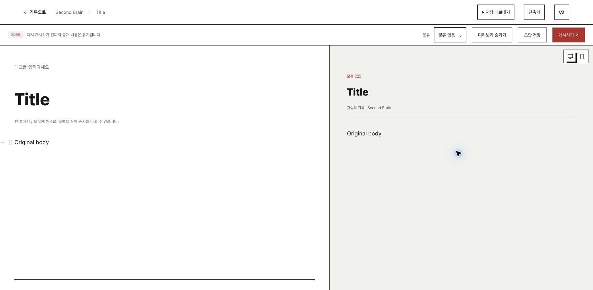
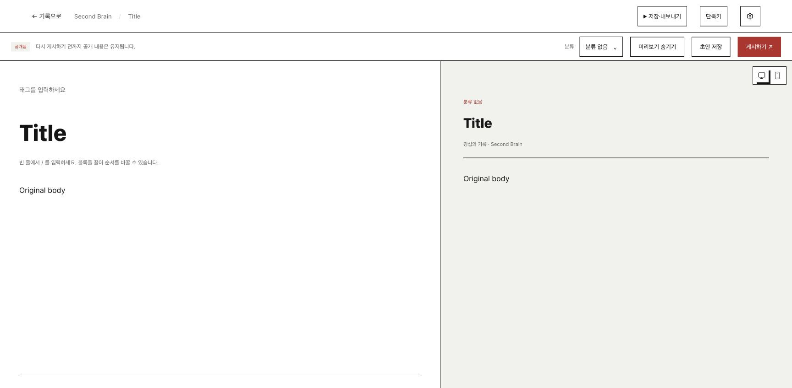
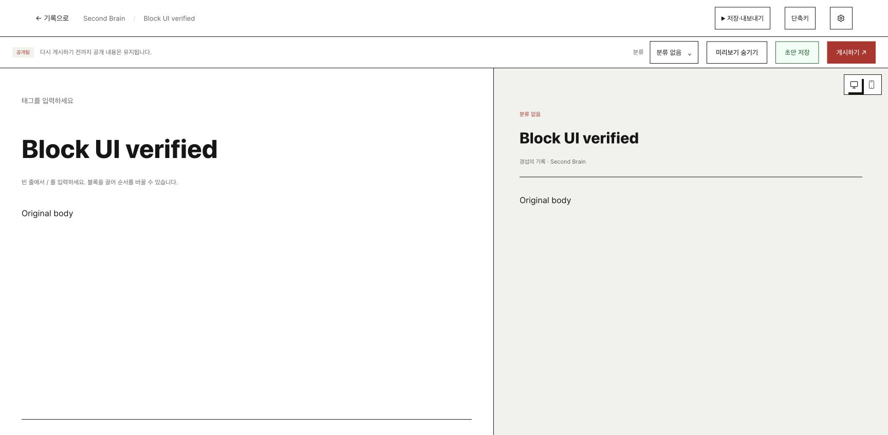

# 기존 Markdown 편집 화면 제거 검증

기존 Markdown 전용 textarea 화면을 제거했다. Markdown만 있는 글과 편집 데이터가 있는 글 모두 기존 블록 편집 화면을 사용한다. 글 제목만 수정하면 원본 Markdown 바이트를 보존한다. 본문을 수정하면 기존 직렬화 경로로 Markdown과 편집 데이터를 함께 저장한다.

제품 변경은 `ManagedPostEditor.tsx`에 한정한다. 기존 도구 모음, 분류, 태그, 독자 미리보기와 내보내기를 재사용한다. 삭제는 기존 콘텐츠 관리 목록에서 수행한다. 잘못된 편집 원본의 복구와 내보내기 경로를 유지한다. 다른 채팅의 저장·workflow 변경을 보존했다.

## 실행한 검사

- 회귀 검사 2개가 기존 구현에서 실패하고 수정 후 통과했다. 실제 본문 편집과 제목 수정 시 원본 보존을 검사한다.
- 최종 `npm run check`: 601개 중 599개 통과. 카테고리 관련 기존 실패 2개가 남았다. 전체 검사 통과로 판정하지 않는다.
- 최종 빌드 성공. 기존 중복 속성 경고와 번들 크기 경고는 남아 있다.
- 독립 코드 검토: 수정할 지적 없음. `git diff --check` 통과.
- 최종 검사 입력 해시와 완료 시점 입력 해시가 같다. 원시 로그는 `.tmp/remove-legacy-editor/`에 있다.

남은 실패: `category action precedes preview and shows the assigned name or empty label`, `tags, category cancellation and reader controls preserve local-only drafts`.

## Chrome 화면·저장 검사

폐기용 로컬 GitHub 프로토콜 서버와 최종 빌드를 사용했다. 변경 전에는 편집 데이터가 있는 글을 열었다. 변경 후에는 Markdown만 있는 같은 글을 열었다. 두 화면은 1728×848에서 같은 블록 편집 구성을 보였다. 스크린샷 차이는 포인터와 블록 조작 핸들 상태를 포함한다. 새 디자인이나 CSS 변경은 없다.

변경 후 제목을 `Block UI verified`로 수정하고 게시 버튼을 눌렀다. 곧바로 새로고침한 뒤 편집 화면을 다시 열어 제목과 본문 복구, `원본 저장 완료` 표시를 확인했다. 서버 조회로 제목 변경, 원본 Markdown `Original body` 바이트 보존, 편집 데이터 해시 일치, 원본 커밋 1회를 확인했다. 실제 사용자 콘텐츠와 GitHub 원격에는 쓰지 않았다. 공개 workflow 완료를 검증한 결과는 아니다.

## 성능 비교

같은 의존성·100개 블록·실제 TipTap 편집 20회로 변경 전후를 각 3회 교차 실행했다. 각 실행은 새 Node/JSDOM 프로세스이며 512MiB 힙과 30초 외부 제한을 사용했다. 중앙값은 진입 163.6→149.7ms, 편집 534.3→449.9ms다. 양쪽 모두 원본 조회 1회, 원격 저장 0회다. 이 검사는 기존 블록 경로의 회귀 검사다. 브라우저 실사용 지연이나 Markdown 파싱 비용 전체를 대표하지 않는다.

실제 브라우저의 대용량 큐 메모리와 native 실행은 이번 변경에서 검사하지 않았다. 이전 보고서의 Markdown 전용 화면은 현재 블록 UI 검증 근거로 사용하지 않는다. 커밋·푸시·배포는 하지 않았다.
