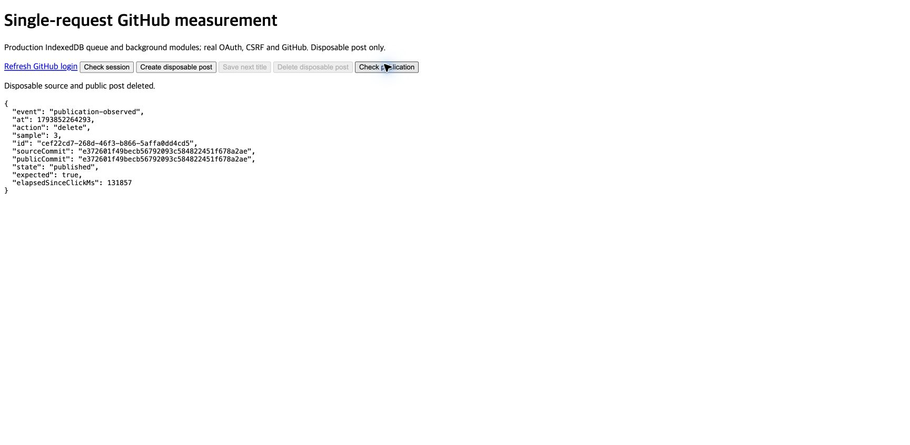

# GitHub 단일 요청 저장 실측

준비된 제목 수정 3회는 **모두 GitHub 호출 1회**로 완료했다. 서버 POST 중앙값은 **6.122→1.599초**다. 관측한 감소율은 **73.9%**다.

이 수치는 실제 OAuth·CSRF·owner 세션의 GitHub 쓰기다. fixture나 캐시 조회를 원격 쓰기로 계산하지 않았다. 각 저장에서 실제 `POST /graphql` mutation이 발생했고 다른 GitHub 호출은 없었다. 초기 원본 준비·복구·공개 작업은 별도로 집계했다.

## 바꾼 저장 흐름

기존 IndexedDB 저장과 화면 반영, 5초 정책은 유지했다. 서버는 준비된 원본으로 내용을 검증한다. `createCommitOnBranch` 한 번으로 파일·커밋·브랜치를 갱신한다. `expectedHeadOid`가 바뀐 원본의 덮어쓰기를 막는다. 별도 tree·commit·request ref 생성과 저장 전후 HEAD 왕복을 제거했다.

동일 mutation은 `.cms/requests/<requestId>.json`도 기록한다. 이 파일에는 요청 ID·payload 해시·기준 commit만 있다. 인증 정보와 본문은 없다. 새 식별자는 `atomic-<UUID>`를 사용한다. 기존 UUID 요청과 대기 데이터는 기존 경로로 처리한다.

전송 여부는 기기에 보관한다. 응답을 잃으면 원래 payload를 바꾸지 않고 읽기 복구를 먼저 요청한다. canonical의 확인 파일과 그 파일을 만든 커밋의 메시지·해시·정확히 한 부모를 확인한다. `clientMutationId`가 중복 저장을 막는다고 가정하지 않는다.

기존 캐시의 32항목·8MiB 한도를 유지했다. 사용하지 않는 Git tree URL을 제거해 검증한 원본을 재사용한다. 분류·링크·editor·첨부 검증은 유지했다. 변경 없는 분류의 원본 bytes도 보존한다.

## 실제 제목 수정 3회

| 표본 | 서버 POST 초 | GitHub 호출 | 실제 mutation | 요청 bytes | 소비한 응답 bytes |
|---|---:|---:|---:|---:|---:|
| 1 | 1.574 | 1 | 1 | 1,923 | 377 |
| 2 | 2.059 | 1 | 1 | 1,932 | 377 |
| 3 | 1.599 | 1 | 1 | 1,932 | 377 |

표본마다 브라우저 벌크 POST는 860 bytes였다. 이전 12회 저장의 중앙값 표본은 GitHub 요청 1,275 bytes와 응답 3,770,349 bytes였다. 새 중앙값 표본은 요청 1,932 bytes와 응답 377 bytes다. GraphQL·확인 파일로 요청 body는 조금 커졌지만, 왕복과 원본 재다운로드를 제거했다.

| 표본 | 기기 저장 완료 ms | 독립 읽기 확인 ms | 화면 반영 ms | 전송 전 대기 초 | 전송→원본 확인 초 | 클릭→원본 확인 초 |
|---|---:|---:|---:|---:|---:|---:|
| 1 | 4.7 | 210.7 | 269.2 | 5.102 | 1.580 | 6.682 |
| 2 | 9.8 | 92.5 | 132.0 | 5.018 | 2.067 | 7.085 |
| 3 | 6.3 | 110.4 | 151.2 | 5.013 | 1.611 | 6.624 |
| 중앙값 | 6.3 | 110.4 | 151.2 | 5.018 | 1.611 | 6.682 |

기기 완료는 IndexedDB transaction 완료 알림이다. 별도 읽기로 저장한 버전을 다시 확인했다. 화면은 실제 production overlay 제목을 확인한 뒤 두 번의 animation frame으로 측정했다. 전체 React 편집기 화면을 측정한 값은 아니다.

5초 대기를 포함하면 백그라운드 완료 중앙값은 6.682초다. 사용자는 이 응답을 기다리지 않는다. 화면 반영 중앙값은 151.2ms였다. 5초 정책을 이번 요청에서 임의로 제거하지 않았다.

## 한 번이 아닌 경로도 기록한다

처음 생성할 때는 검증할 원본이 없었다. 원본 commit·tree·분류 준비 3회와 mutation 1회가 발생했다. 서버 POST는 7.259초였다. 이 준비 비용을 숨겨 모든 저장이 한 번이라고 보고하지 않는다.

실제 수락된 세 번째 요청을 같은 payload로 다시 확인했다. 기기에 보관한 요청과 복구 header를 사용했다. 추가 mutation은 **0회**였고 같은 commit을 반환했다. 원본 HEAD도 같았다. 캐시가 비어 있던 원본 준비를 포함해 읽기 8회·4.465초였다. 확인 파일과 부모·메시지 검증은 실제 서버를 통과했다. [복구 기록](recovery.json).

이 검사는 이미 수락된 요청의 재확인이다. 실제 네트워크 패킷을 끊은 검사는 아니다. 응답 유실·재시작·중복 탭·충돌·일시 오류의 강제 주입은 작은 fixture에서 검사했다.

첨부 SHA를 많은 이름에서 재사용하면 작은 입력도 큰 base64로 확장된다. 인코딩 전 합산 크기를 계산한다. 큰 저장은 기존 SHA 기반 Git-data 경로를 사용한다. 그 경로는 추가 호출이 발생한다. 기존 인라인 제한은 파일당64KiB·합계1MiB다. 기존에 저장할 수 있던 내용을 새 제한으로 거절하지 않는다. 확인 파일은 요청마다 늘어난다. 기존 recursive tree의 크기·항목 한도를 받으므로 장기 대량 저장은 별도 관리가 필요하다.

## 기존 workflow와 공개 완료

기존 workflow YAML·명령·generator pin은 바꾸지 않았다. 실제 공개 workflow 5회가 모두 성공했다. 원본은 `saved`, 공개 준비 완료는 `published`로 확인했다. 이전 정상 공개본과 `public-ready/main`의 동작도 유지했다.

| 작업 | source commit | 실제 workflow | 결과 |
|---|---|---|---|
| 임시 글 생성 | `9a6362b245e2d1a6f310a9ec2518c22ee8bb7b2a` | [실행 41965497446](https://github.com/gyungsubLee/subdev-blog-content/actions/runs/41965497446) | success |
| 제목 수정 1 | `e7cf97a32afcb712295edd7c623442ee7231c17a` | [실행 41965737952](https://github.com/gyungsubLee/subdev-blog-content/actions/runs/41965737952) | success |
| 제목 수정 2 | `d97b526fd9837d7a5bf9ab7ef85b026f65eb69b0` | [실행 41965984059](https://github.com/gyungsubLee/subdev-blog-content/actions/runs/41965984059) | success |
| 제목 수정 3 | `da120cc94884bd0bbd33006a5bfddc29c406154a` | [실행 41966266774](https://github.com/gyungsubLee/subdev-blog-content/actions/runs/41966266774) | success |
| 임시 글 삭제 | `e372601f49becb56792093c584822451f678a2ae` | [실행 41966688217](https://github.com/gyungsubLee/subdev-blog-content/actions/runs/41966688217) | success |

| 제목 표본 | 공개 workflow 호출 | 공개 쓰기 | 요청 bytes | 소비한 응답 bytes | 공개 준비 추정 초* |
|---|---:|---:|---:|---:|---:|
| 1 | 23 | 5 | 6,903,386 | 12,430,407 | 73.831 |
| 2 | 23 | 5 | 6,903,386 | 12,430,763 | 77.308 |
| 3 | 23 | 5 | 6,903,386 | 12,431,047 | 73.907 |

*공개 준비는 runner의 ready PATCH 응답 시각과 브라우저 클릭 시각을 비교한 추정이다. 중앙값은 73.907초다. 시계 오차 한도는 측정하지 않았다. 수동 공개 확인 시간은 늦게 조회한 상한이므로 공개 지연으로 사용하지 않는다.

일반 저장 1회와 공개 23회를 합치면 표본당 24호출·6쓰기다. 이전 12회 저장과 공개 23회는 35호출·9쓰기였다. 이 합계에는 상태 확인·사전 조회·OAuth·checkout·npm·감사 요청이 없다. “전체 작업이 네트워크 한 번”이라는 뜻은 아니다.

공개 상태 확인도 raw trace에 보존했다. 긴 측정 화면에서 81회 조회가 발생했고 GitHub·raw 읽기는447회였다. 이 화면은 React 구독자의 공개 반영 후 기록 정리를 실행하지 않았다. 정상 편집기 한 저장의 조회 수로 해석하지 않는다. 실제 읽기 복구와 준비 호출도 숨기지 않는다.

## 원본 보존과 정리

기존 **10,292개 파일의 모든 SHA가 같고 글 수는3,032개**다. 임시 글의 Markdown·editor 원본과 공개 항목은 삭제했다. 복구 보장을 위해 요청 확인 파일5개는 유지한다. 총 원본 파일 수는10,297개다. 확인 파일의 Git SHA도 실제 payload 해시·부모 순서로 재계산해 모두 일치했다. [원본 감사](state-after.json), [확인 파일 증명](analysis.json).

generator pin은 전후 모두 `e763d9adf0e07f77a1b0177895674f08922f9122`다. 앱 main도 `27441173f257769add825aea596f7080d282e1ca`로 같다. 앱 main 병합·배포·native rebuild와 checkout staging·commit·push는 하지 않았다. 기존 dirty 변경은 보존했다.

작업 소유 탭 두 개와 서버·callback listener를 닫았다. 임시 정적 복구 페이지도 정리했다. 다른 소유자의 preview와 탭은 유지했다.

## 검사와 제한

- atomic·캐시·복구·sync-core 최종 집중 검사40/40 통과. 대용량 합산 경계 검사1/1 통과.
- 수정한 클라이언트 계약14/14 통과. 기존 서버 회귀80개는 통과했다.
- sandbox의 Vite listen EPERM target은 종료를 확인한 뒤 소켓 환경에서2/2 통과했다.
- 원자적 로컬 HTTP·trace 검사2/2와 TypeScript·최종 build 통과.
- [독립 검토](review.md)에서 발견한 경계를 수정했고 재검토 승인을 받았다. 겹치는 검사 수는 합산하지 않는다.

기존 bundle 크기·`updatedAt` 경고와 INDEX 크기 초과는 남았다. 전체 suite를 다시 실행하지 않았다. 이전 편집기 실패 두 개가 해결됐다고 주장하지 않는다. 전체 React 편집기 지연·브라우저 대용량 큐 메모리·실제24시간 방치는 미검증이다. 이전 Node43.2MiB 큐의1.31GiB RSS 한계를 해결한 작업은 아니다.

이전과 현재의 GitHub·브라우저 부하와 네트워크 조건은 같다고 보장하지 않는다. 보고한 시간 감소는 실제 세 표본의 관측값이다. 요청 수1회와 실제 mutation은 각 trace에서 직접 확인했다.

처음 복구 검사 HTML은 custom Vite의 HTML 경로에서404였다. task-owned public 정적 경로에서 검사했고 그 파일을 삭제했다. 제품 오류나 측정 표본 실패로 분류하지 않는다.

## 증거

[구조화 분석](analysis.json), [실제 API trace](live-report.json), [전체 표](measurement-tables.md), [검사·소스 바인딩](verification.json), [실측 소스 해시](measurement-source-hashes.json), [구현 diff](worker.patch), [실행 계획](../../superpowers/plans/2026-11-05-single-request-save.md). 이전 비교는 [12회 실측](../2026-11-05-optimistic-workflow/README.md)이다.

