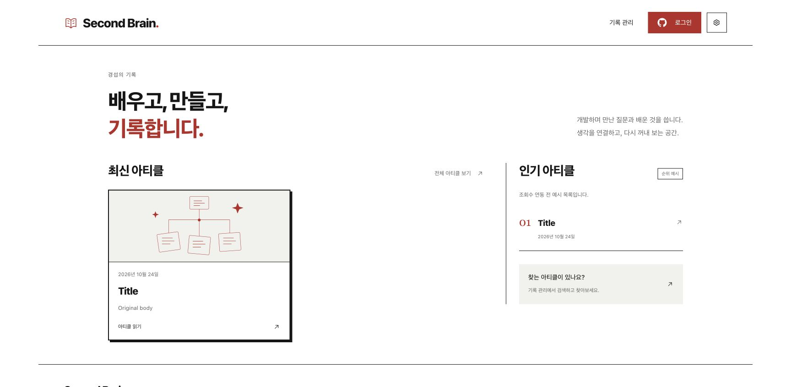

# 구현 기능 조사와 CRUD 검증 결과

실제 GitHub 인증·글과 카테고리 CRUD, 네이티브 직접 조작 검사까지 완료했다.
후속 검사에서 발견한 저장 상태·삭제 글 재표시·실패 복구 오류를 수정했다. 전체 Node 664개가 통과했다.
마지막 복구 버튼 조건 수정 뒤에는 영향받는 두 파일의 48개 검사와 빌드도 통과했다.

원격 원본 파일 10,302개를 보존했고 테스트 항목을 정리했다. 공개 workflow도 성공했다.
기존 UI를 유지하며 실패 복구에 필요한 기존 버튼의 표시 조건만 보완했다.
실제 실행·원본 비교·최신 검사와 남은 경계는 [최종 실제 환경 리포트](live/README.md)에 기록했다.

## 최초 격리 검사 결과

아래 내용은 후속 실제 검사 전에 완료한 격리 검사 기록이다. 당시의 미검증 범위와 후속 결과를 구분한다.

구현 기능을 조사하고 재현한 오류 4건을 수정했다. 통합 Node 검사 630개, HTTP 검사 7개, 네이티브 Python 검사 2개가 통과했다.
마지막 삭제 상태 수정 뒤에는 카테고리 검사 13개와 빌드를 다시 통과했다. 독립 검토의 최종 판정도 통과다.

기준일은 2026-11-07 KST다. 최초 격리 검사에서는 실제 원격 저장소의 글을 변경하지 않았다.
그때 제외한 실제 GitHub 인증·원격 쓰기·macOS 창 조작의 후속 결과는 위 실제 환경 리포트에 구분해 기록한다.

## 조사 범위

웹, 서버, 콘텐츠, 공용 문서 처리와 네이티브 구현을 조사했다.
세 영역의 담당 에이전트와 독립 검토 에이전트를 사용했다. 부모 에이전트가 HTTP 검사, 빌드와 Chrome 확인을 맡았다.
각 영역의 구현 기능과 검사 파일은 다음 문서에 연결했다.

- [웹 기능 목록과 검사](web.md): 탐색, 관리 화면, 편집기, 초안, 가져오기·내보내기, 첨부, 동기화, 테마.
- [서버 기능 목록과 검사](server.md): 인증, 권한, 문서·카테고리 CRUD, 원자적 저장, 충돌, 재시도, 공개 생성과 캐시.
- [콘텐츠·네이티브 기능 목록과 검사](content-native.md): 원본 읽기·쓰기, 문서 형식, 링크, 첨부, CLI와 앱 실행 경계.
- [독립 검토와 수정 후 판정](review.md): 초기 P1 발견을 보존하고 마지막 절에 해소 근거를 기록했다.
- [실행 계획](../../superpowers/plans/2026-11-07-feature-audit.md).

## CRUD 결과

CRUD는 생성, 조회, 수정, 삭제를 뜻한다. HTTP 검사는 실제 서버 핸들러와 일회용 GitHub 프로토콜 fixture를 연결한다.
fixture는 메모리에 Git 객체를 보관한다. 실제 콘텐츠 저장소와 원격 GitHub에는 쓰지 않는다.

| 대상 | 생성 | 조회 | 수정 | 삭제와 보존 |
|---|---|---|---|---|
| 글 | 새 UUID와 원본 생성 | 같은 커밋의 원본·공개 본문 조회 | 제목·본문·분류, 새 revision 사용 | 원본 삭제 뒤 공개 목록에서 제외, 다른 글 보존 |
| 카테고리 | 분류와 하위 분류 생성 | 원본 목록·revision·commit 조회 | 이름 변경, 상위 분류 변경, 삭제 뒤 후속 저장 | 미분류 이동과 글 전체 삭제 모두 확인, 자식이 있는 부모 보호 |
| 초안 | 로컬 빈 초안 생성 | 복구와 손상한 바이트 보존 | 자동 보관, 편집 JSON과 Markdown의 같은 저장 시점 | 로컬 삭제와 정식 글 삭제 구분, 실패 때 복구 |
| 첨부 | 업로드와 이름 예약 | 커밋에 고정한 첨부 바이트 | 게시 뒤 새 첨부와 전송 중인 저장의 분리 | 글 전체 삭제와 함께 정리, 다른 글의 첨부 보존 |

새 [카테고리 HTTP 검사](../../../tests/e2e/category-crud-http.test.mjs)는 다음 흐름을 한 서버에서 연결한다.

1. 부모·자식 카테고리를 생성한다.
2. 자식이 있는 부모 삭제를 `409`로 거부하고 원본 커밋을 보존한다.
3. 자식 이름과 상위 카테고리를 바꾼다.
4. 글을 만든 뒤 카테고리를 삭제하고 글을 미분류로 이동한다.
5. 실제 `saved` 응답을 확인하고 새 카테고리 revision으로 다음 변경을 저장한다.
6. 이전 revision의 저장은 거부한다.
7. 카테고리와 소속 글을 삭제한 뒤 같은 요청을 재시도한다. 커밋은 추가하지 않는다.
8. 공개 데이터를 생성해 삭제한 글과 카테고리의 부재, 다른 글의 보존을 확인한다.

기존 HTTP 검사는 글 CRUD, 인증·CSRF 거부, 원자적 저장, 응답 유실 복구, 공개 생성 실패와 재시도도 검사한다.
서버 검사는 권한, 문서·편집 revision, 경로 이탈, 예약 파일명, 첨부 충돌과 부분 저장 방지를 확인한다.

## 수정한 오류

| 오류 | 확인한 원인 | 수정 | 회귀 근거 |
|---|---|---|---|
| 삭제 성공을 실패로 표시 | 카테고리 삭제의 실제 성공 상태 `saved`를 웹이 거부 | 원본 저장 성공으로 인정하고 공개 완료와 구분 | 실제 응답 fixture에서 2개 실패 후 카테고리 13개 통과 |
| 삭제 뒤 다음 저장 충돌 | 삭제 전 `contentCommit`과 `revision`을 초안에 보관 | 삭제 확정 뒤 새 원본·버전·캐시를 함께 갱신 | 새 버전 저장, 삭제 행 부재, 조회 실패 뒤 같은 요청 재시도 |
| 게시 직후 첨부 업로드 실패 | `accepted` 검사가 백그라운드 저장 중 편집까지 차단 | 기존 편집기의 `busy` 조건과 업로드 조건을 일치 | 업로드 성공, 이름 중복 차단, 이전 저장 확인 뒤 첨부 보존 |
| 없는 날짜 허용 | `Date.parse`가 잘못된 날짜를 다음 달로 보정 | 시간대 변환 전 입력 일자를 추가 검사 | 잘못된 윤일·월말 거부, 정상 윤일·offset 보존 |

제품 변경은 세 파일에 한정했다.

- `app/web/src/features/content-management/ManagedCategories.tsx`
- `app/web/src/features/content-management/ManagedPostEditor.tsx`
- `app/shared/document.mjs`

새 회귀 검사는 웹 4개와 공용 날짜 2개다. HTTP 카테고리 검사 1개도 추가했다.
첫 검토에서 실제 API와 웹 fixture의 응답 차이를 발견했다. 실제 `saved` 응답으로 검사를 고친 뒤 제품을 수정했다.
잘못된 fixture를 유지한 채 통과한 결과를 최종 삭제 검증으로 사용하지 않았다.

## 실행한 검사

Node 검사는 `--test-concurrency=2`로 실행했다. 전체 Node 검사에는 240초, HTTP 검사에는 150초의 외부 기한을 적용했다.
기록한 실행은 모두 종료 코드를 확인했다. 아래의 통과 실행에는 취소하거나 건너뛴 검사가 없다.

| 검사 | 결과 | 근거 |
|---|---|---|
| 네 영역의 전체 Node 검사 | 630개 통과, 135.73초 | [전체 로그](logs/subdev-audit-full-node.log) |
| 마지막 삭제 상태 수정 후 카테고리 검사 | 13개 통과, 21.46초 | [실패 재현](logs/subdev-web-saved-red.log), [수정 후 로그](logs/subdev-web-saved-green.log) |
| 전체 HTTP E2E 검사 | 7개 통과, 7.95초 | [HTTP 로그](logs/subdev-audit-e2e-final.log) |
| 수정 후 실제 콘텐츠 검사 | 글 3,032개·카테고리 48개·참조 첨부 7,255개, 오류 0개 | [콘텐츠 로그](logs/subdev-check-content-final.log) |
| 네이티브 Python 검사 | 2개 통과, 14.041초 | [네이티브 로그](logs/subdev-check-native.log) |
| 마지막 수정 후 `npm run build` | 버전·TypeScript·Vite 빌드 통과, 37.70초 | [빌드 로그](logs/subdev-audit-build-complete.log) |
| 독립 검토 | 초기 P1 해소, 최종 요구사항·코드 품질 통과 | [검토 기록](review.md) |
| 제품 소스·검사 코드의 공백 검사 | 통과, 원본 실행 로그의 출력 공백은 보존 | `git diff --check -- app/shared/document.mjs app/web/src tests` |

전체 Node 명령은 다음과 같다. `npm run check`와 같은 네 영역의 대상을 실행하되 동시 실행 수를 제한했다.
버전 검사와 TypeScript 검사는 마지막 `npm run build`에 포함했다.

```sh
node --test --test-concurrency=2 tests/web/*.test.mjs tests/server/*.test.mjs tests/content/*.test.mjs tests/native/*.test.mjs
node --test --test-concurrency=2 tests/web/managed-categories.test.mjs
node --test --test-concurrency=2 tests/e2e/*.test.mjs
npm run check:content
npm run check:native
npm run build
```

630개 통합 검사는 마지막 `saved` 허용 수정 전에 끝났다.
그 뒤 변경한 카테고리 파일의 13개 검사와 빌드를 다시 실행했다. 서버 계약과 나머지 소스가 같은 검사는 기존 근거를 재사용했다.
중복 검사 개수를 합산해 더 많은 검사를 실행한 것처럼 세지 않았다.

최초 서버·네이티브 검사에는 sandbox의 포트 제한 `EPERM`이 있었다.
네이티브 preview는 권한을 허용한 재검사에서 통과했다. 서버 Vite 검사는 같은 소스를 포함한 전체 630개 실행에서 통과했다.
기능 실패와 실행 권한 실패를 구분했으며 검사 코드를 건너뛰거나 조건을 낮추지 않았다.

## UI 확인

제품 JSX, CSS, 문구, 버튼과 화면 구성은 바꾸지 않았다. 새 화면을 만들지 않았다.
연결된 Chrome의 전용 탭에서 기존 홈, 기록 목록, 빈 검색 결과, 검색 초기화와 글 본문을 확인했다.
운영 로그인 대신 격리 데이터의 공개 화면을 사용했다.

홈 화면은 같은 입력과 1728×848 크기로 수정 전후를 캡처했다.
[비교 결과](ui-comparison.json)는 픽셀 일치를 보고한다. [수정 전 화면](home-before.png)과 [기록 화면](records-before.png)도 보존했다.
마지막 상태 허용 수정은 카테고리 삭제 조건 한 줄이며, 홈·스타일·정적 화면에는 영향을 주지 않는다.



최초 격리 검사에서는 카테고리 관리와 편집기의 실제 Chrome CRUD 조작을 실행하지 않았다.
그 경로는 JSDOM 회귀와 실제 핸들러를 연결한 HTTP 검사로 확인했다. 이 결과를 모든 화면 크기의 시각 검증으로 확대하지 않는다.

## 성능과 데이터 보존

공개 캐시, 편집기 지연 로딩, 세션 요청 병합, 미리보기 지연, 동기화 큐 병합과 자원 정리를 유지했다.
일반 카테고리 조회·저장의 요청 수는 같고, 삭제가 확정된 경로에만 원본 조회 1회를 추가했다.
이 조회는 다음 저장의 충돌을 막는 데 필요하다. 삭제 완료까지의 지연이 변경 전과 같다고 주장하지 않는다.
게시 뒤 첨부에는 원본 재조회가 없고, 같은 이름의 두 번째 업로드 요청도 없다.

날짜 검사 전후에 같은 문서 2,000개를 9회씩 파싱했다.
중앙값은 99.663ms에서 100.697ms로 바뀌었다. 추가 비교 비용은 이 측정에서 문서당 0.517µs였다.
잘못된 날짜를 거부하는 경계를 유지했고 기존 변환 캐시는 제거하지 않았다.
전체 콘텐츠 검사는 같은 집계에서 24.91초와 22.00초였다. 병렬 작업과 파일 캐시의 영향 때문에 속도 향상으로 단정하지 않는다.

HTTP 일괄 저장 검사는 작업 3개를 순차 요청 3회·커밋 3개와 일괄 요청 1회·커밋 1개로 비교했다.
같은 로컬 API 지연 350ms에서 마지막 측정은 1,130.254ms와 365.233ms였다.
[초기 측정](http-bulk-initial.json)과 [마지막 측정](http-bulk-final.json)을 이번 폴더에 남겼다.
검사가 자동으로 덮어쓴 과거 측정 파일은 실행 전 내용으로 복원했다.

시작 시 있던 `app/server/src/public-files.mjs`의 마지막 빈 줄과 `content/.github/` 변경을 보존했다.
전체 `git diff --check`는 기존 빈 줄을 보고하므로 이번 변경만 별도로 확인했다.
콘텐츠 기준 커밋은 `9f99941c6b650c70f363208cd97c7191ef785a46`이며 상태는 기존 `git-local-dirty`다.
앱 기준 HEAD는 `fb7675bcf309ddd0747f9902c9c275958cd13aa5`다. 실행 환경과 입력 해시는 [검증 기록](verification.json)에 보관한다.

## 최초 격리 검사의 검증 경계

- 최초 격리 검사에서는 실제 GitHub OAuth, 운영 원격 쓰기, Actions 공개 workflow와 운영 배포를 실행하지 않았다.
- 최초 격리 검사에서는 실제 macOS 앱의 로그인 왕복, 창 조작, 다운로드 패널과 전체 `.app` 빌드를 실행하지 않았다.
- 이전 백업 checkout을 요구하는 과거 Notion 수집·자산 도구의 실서비스 실행은 생략했다. 현재 CLI 제한은 하위 보고서에 명시했다.
- 모바일 화면과 모든 편집 상태의 시각 비교, 실제 GitHub 지연·CPU·메모리·GPU 성능은 측정하지 않았다.
- 기존 빌드 청크 크기, 중복 `updatedAt`, JSDOM·React 경고를 숨기지 않았다. 요청 범위 밖 구조 정리로 확대하지 않았다.
- 기존 `.project-context/INDEX.md`는 helper의 크기 제한을 넘었다. 과거 기록을 축약하거나 삭제하지 않고 이번 결과를 별도 checkpoint로 남겼다.

최초 격리 검사에서 재현한 네 오류는 수정과 검증을 끝냈다.
후속 실제 CRUD 커밋과 추가 수정은 [실제 환경 리포트](live/README.md)에 구분했다. 앱 코드의 커밋·푸시·수동 배포는 실행하지 않았다.
